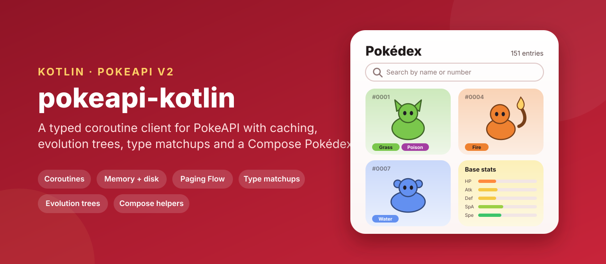
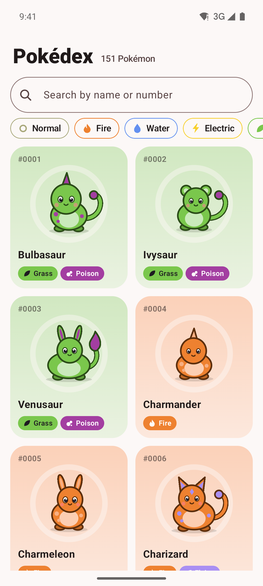
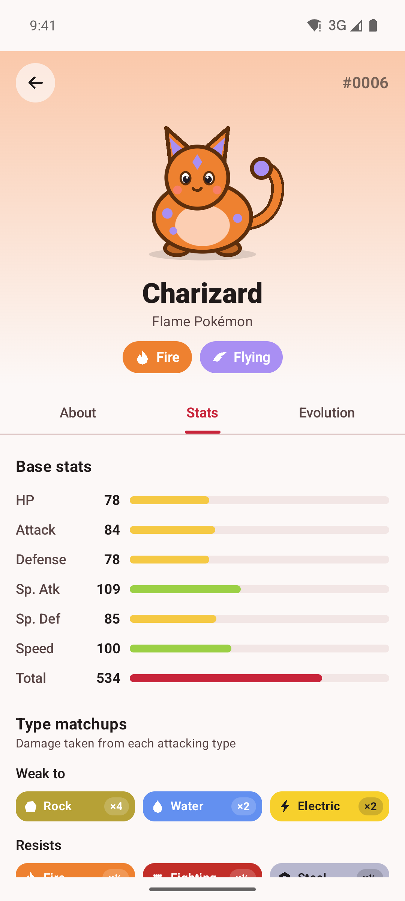
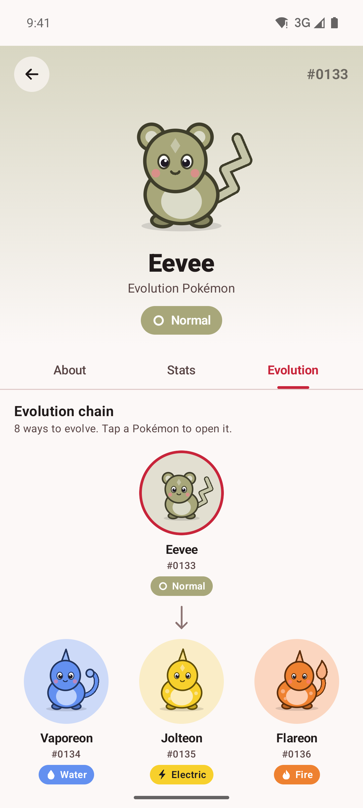
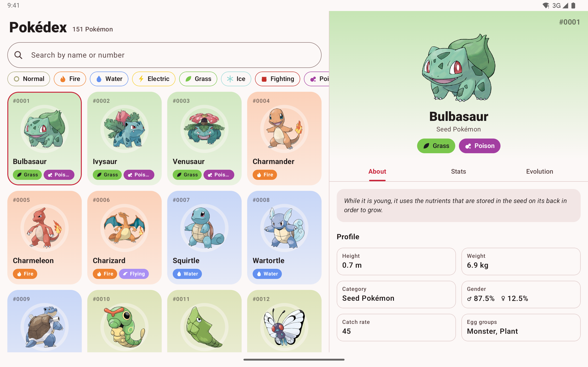
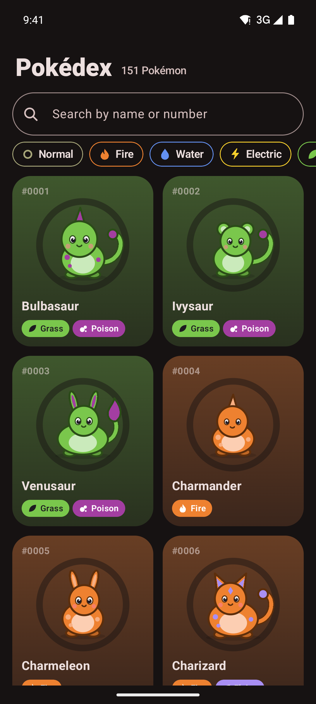
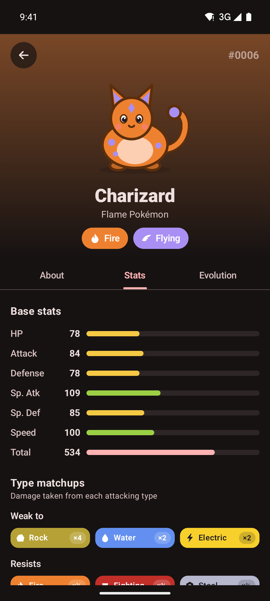
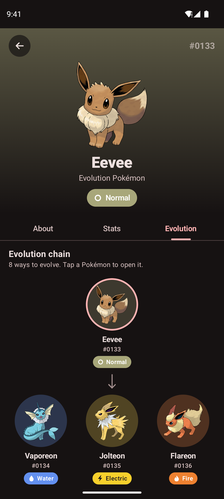
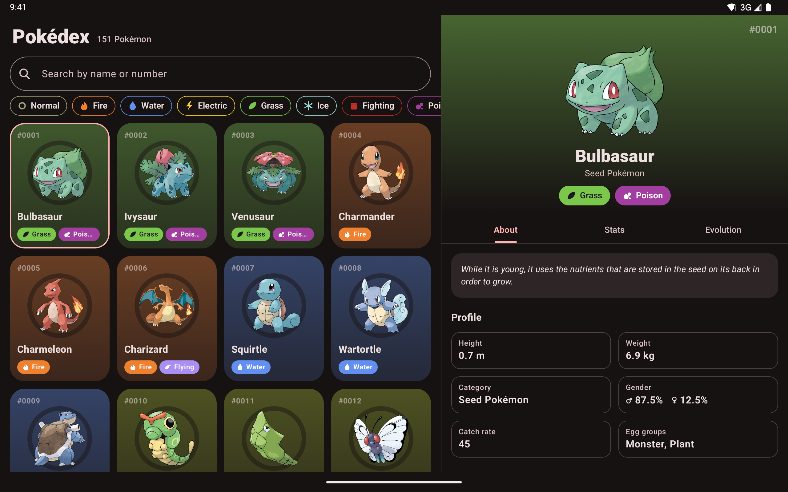

<p align="center">
  
</p>

<p align="center">
  <a href="https://github.com/halilozel1903/pokeapi-kotlin/actions/workflows/ci.yml"></a>
  <a href="https://jitpack.io/#halilozel1903/pokeapi-kotlin"></a>
  
  
  
  
  
  <a href="LICENSE"></a>
</p>

**pokeapi-kotlin** is a Kotlin client for [PokeAPI v2](https://pokeapi.co/docs/v2). It gives you typed models with PokeAPI's real field names mapped to Kotlin properties, `suspend` functions for every common endpoint, paging as a `Flow`, an in-memory and disk cache (PokeAPI asks clients to cache), evolution trees you can flatten and walk, and a type effectiveness calculator that handles dual types. The core is pure Kotlin/JVM (Ktor and kotlinx.serialization), so it runs on Android, on the server and in tests. An optional Compose module adds type chips with type colors, stat bars, evolution rows and a type matchup grid, and the sample app is a full Pokédex for phones and tablets.

```kotlin
val client = PokeApiClient()

val charizard = client.pokemon("charizard")
charizard.pokeTypes                              // [Fire, Flying]
charizard.officialArtworkUrl                     // sprites.other["official-artwork"].front_default
charizard.defensiveMatchups().quadrupleWeaknesses   // [Rock]

val species = client.pokemonSpecies(charizard)
species.genus()                                  // "Flame Pokémon"
species.flavorText(version = "red")              // "Spits fire that is hot enough to melt boulders. ..."

val chain = client.evolutionChain(species)!!
chain.flatten().map { it.name to it.condition }  // [(charmander, null), (charmeleon, Level 16), (charizard, Level 36)]
```

## Screenshots

Captured live from PokeAPI by CI, with the sample app on Android emulators. Names, types, stats, evolutions and the official artwork are real data loaded from pokeapi.co and PokeAPI's sprites repository during the run.

| Grid with search and type filters | Base stats and type matchups | Branching evolution chain |
| :---: | :---: | :---: |
|  |  |  |

**Tablet:** grid and detail side by side, here Bulbasaur's profile and abilities.



| Grid, dark | Stats, dark | Evolution, dark | Tablet, dark |
| :---: | :---: | :---: | :---: |
|  |  |  |  |

## Features

- **Typed models** for Pokémon, species, evolution chains, types, abilities, moves, items, generations, Pokédexes and berries, with `NamedAPIResource` links that know their `id`. Unknown fields are ignored, so new PokeAPI fields do not break you.
- **Coroutines**: every call is a main-safe `suspend` function that throws a `PokeApiException` (`NotFound`, `Http`, `Network`, `Decoding`).
- **Paging**: `list()` for one page, `pages()` and `all()` as cold `Flow`s that follow `next` links lazily.
- **Caching**: in-memory LRU by default, plus an optional disk cache (`memory + disk`), with TTLs, three cache policies (cache first, network first with offline fallback, network only) and de-duplication of identical requests running at the same time.
- **By id or name**: names are normalized, so `"Mr. Mime"`, `"Farfetch'd"` and `"Nidoran♀"` work.
- **Localized texts**: names, genera and Pokédex entries in any PokeAPI language, with the game text cleaned (`\n`, `\f`, soft hyphens).
- **Evolution trees**: flatten, group by stage, list every path, find a species, and describe each method in English ("Level 16", "Use Water Stone", "High friendship, day", "Trade holding Metal Coat").
- **Type effectiveness**: the full chart of the current games built in, dual types multiplied (4x, 2x, ½, ¼, 0), weaknesses, resistances, immunities and offensive coverage. It can also be computed from PokeAPI's own `damage_relations`.
- **Sprites without requests**: official artwork, HOME and in-game sprite urls from an id, so a grid from a list needs no request per Pokémon.
- **Pluggable HTTP**: Ktor with the CIO engine by default; pass OkHttp, Android, Java or a `MockEngine`, a ready `HttpClient`, or replace HTTP with your own `PokeApiTransport`.
- **Test fixtures**: `FixtureTransport` serves JSON files by url, for your own unit tests and offline demos.
- **Compose helpers** (optional module): `TypeChip`, `TypeIcon` (drawn glyphs), type colors, `StatBar` and `BaseStats`, `EvolutionChainView`, `EvolutionRow`, `EvolutionTree` and `TypeMatchupGrid`.
- **Explicit API**, unit tested against fixtures with PokeAPI's real field names and nesting.

### API coverage

| PokeAPI endpoint | Function | Returns |
| --- | --- | --- |
| `GET /pokemon/{id or name}` | `pokemon(id)`, `pokemon(name)` | `Pokemon` |
| `GET /pokemon-species/{id or name}` | `pokemonSpecies(id)`, `pokemonSpecies(name)`, `pokemonSpecies(pokemon)` | `PokemonSpecies` |
| `GET /evolution-chain/{id}` | `evolutionChain(id)`, `evolutionChain(species)` | `EvolutionChain` |
| `GET /type/{id or name}` | `type(id)`, `type(name)`, `type(PokeType.Fire)` | `Type` |
| `GET /ability/{id or name}` | `ability(id)`, `ability(name)` | `Ability` |
| `GET /move/{id or name}` | `move(id)`, `move(name)` | `Move` |
| `GET /item/{id or name}` | `item(id)`, `item(name)` | `Item` |
| `GET /generation/{id or name}` | `generation(id)`, `generation(name)` | `Generation` |
| `GET /pokedex/{id or name}` | `pokedex(id)`, `pokedex(name)` | `Pokedex` |
| `GET /berry/{id or name}` | `berry(id)`, `berry(name)` | `Berry` |
| `GET /{endpoint}?offset=&limit=` | `list(endpoint, offset, limit)`, `pages(endpoint)`, `all(endpoint)`, `nextPage(page)` | `NamedApiResourceList`, `Flow` |
| Any resource link | `follow(resource, endpoint)`, `fetch(url, serializer)` | the model |
| `GET /type/{name}` x 18 | `typeIndex()` | `Map<String, List<PokeType>>` |
| Sprites | `PokeApiSprites.officialArtwork(id)`, `home(id)`, `front(id)` | url |

## Installation

Add JitPack to `settings.gradle.kts`:

```kotlin
dependencyResolutionManagement {
    repositories {
        google()
        mavenCentral()
        maven("https://jitpack.io")
    }
}
```

Then the dependency:

```kotlin
dependencies {
    implementation("com.github.halilozel1903.pokeapi-kotlin:pokeapi:1.0.0")

    // Optional: Jetpack Compose helpers (type chips, stat bars, evolution views, matchup grid).
    implementation("com.github.halilozel1903.pokeapi-kotlin:pokeapi-compose:1.0.0")

    // Optional: use OkHttp instead of Ktor's CIO engine.
    implementation("io.ktor:ktor-client-okhttp:3.6.0")
}
```

> The build is also set up for Maven Central (`io.github.halilozel1903:pokeapi`) via the vanniktech publish plugin.

`pokeapi` is a plain Kotlin/JVM library (JDK 17+), so it also works in server and desktop projects.

## Usage

**Create a client**

```kotlin
val client = PokeApiClient {
    engine = OkHttp.create()                     // default: CIO
    cache = PokeApiCache.memory(maxEntries = 500) +
        PokeApiCache.disk(File(context.cacheDir, "pokeapi"), ttl = 7.days)
    cachePolicy = CachePolicy.CacheFirst         // or NetworkFirst (offline fallback), NetworkOnly
    userAgent = "my-pokedex/1.0 (+https://example.com)"
    requestTimeoutMillis = 15_000
    retries = 2                                  // network errors and 5xx, with backoff
}
// ...
client.close()
```

Create one client and share it; it is safe to use from many coroutines. Identical requests running at the same time share one network call, and cached responses are reused across app starts with the disk cache.

**Pokémon and species**

```kotlin
val pikachu = client.pokemon(25)
pikachu.baseStat(BaseStat.Speed)                 // 90
pikachu.baseStatTotal                            // 320
pikachu.heightMeters                             // 0.4
pikachu.abilities.first { it.isHidden }.ability.name   // "lightning-rod"
pikachu.dexNumber                                // "#0025"

val species = client.pokemonSpecies("pikachu")
species.localizedName("ja-Hrkt")                 // "ピカチュウ"
species.genus()                                  // "Mouse Pokémon"
species.flavorText()                             // the newest English Pokédex entry, cleaned
species.femaleRatio                              // 0.5, or null when genderless
```

**Evolution chains**

```kotlin
val eevee = client.evolutionChain(client.pokemonSpecies("eevee"))!!.chain

eevee.isLinear                                   // false
eevee.levels().map { stage -> stage.map { it.name } }   // [[eevee], [vaporeon, jolteon, flareon, espeon, ...]]
eevee.paths().size                               // 8
eevee.find("espeon")?.evolutionDetails?.describe()      // "High friendship, day"
eevee.flatten().last().condition                 // "High affection, knows a Fairy move" (Sylveon)
```

**Type effectiveness**

```kotlin
TypeChart.effectiveness(PokeType.Rock, listOf(PokeType.Fire, PokeType.Flying))   // 4.0
TypeChart.effectiveness(PokeType.Ground, listOf(PokeType.Fire, PokeType.Flying)) // 0.0

val matchups = TypeChart.defending(PokeType.Water, PokeType.Ground)
matchups.quadrupleWeaknesses                     // [Grass]
matchups.immunities                              // [Electric]
matchups.resistances                             // [Fire, Poison, Rock, Steel]

// Gaps in a move set's coverage:
TypeChart.coverage(listOf(PokeType.Ice, PokeType.Electric)).filterValues { it <= 1.0 }.keys

// The same from PokeAPI's damage_relations:
TypeMatchups.fromTypes(listOf(client.type("water"), client.type("ground")))
```

**Lists and paging**

```kotlin
val page = client.list(PokeApiEndpoint.Pokemon, offset = 0, limit = 151)
page.results.map { PokeApiSprites.officialArtwork(it.id!!) }   // artwork without one request per Pokémon

client.pages(PokeApiEndpoint.Berry, pageSize = 50).collect { page -> println(page.results.size) }
client.all(PokeApiEndpoint.Item).take(10).toList()

// Colour a grid: types for every Pokémon from 18 requests.
val types: Map<String, List<PokeType>> = client.typeIndex()
```

**Moves, abilities, items and more**

```kotlin
client.move("thunderbolt").shortEffect()         // "Has a 10% chance to paralyze the target."
client.ability("overgrow").shortEffect()
client.item("thunder-stone").sprites?.defaultSprite
client.generation("generation-i").pokemonSpecies.size   // 151
client.pokedex("kanto").pokemonEntries
client.berry("cheri").flavors

// Follow any link in a response:
val growthRate = client.fetch(species.growthRate!!.url, MyGrowthRate.serializer())
```

**Errors**

```kotlin
try {
    client.pokemon("missingno")
} catch (e: PokeApiException.NotFound) {
    // no such Pokémon
} catch (e: PokeApiException.Network) {
    // offline or timed out; CachePolicy.NetworkFirst falls back to the cache for you
}
```

**Testing your code with fixtures**

```kotlin
val client = PokeApiClient {
    // fixtures/pokemon/pikachu.json, fixtures/evolution-chain/10.json, fixtures/berry/list-0-20.json, ...
    transport = FixtureTransport { path -> javaClass.getResource("/fixtures/$path")?.readText() }
}
```

Or pass a Ktor `MockEngine` as `engine`, as this library's own tests do.

### Compose helpers

```kotlin
TypeChip(PokeType.Fire)                                          // filled pill with a drawn flame
TypeChip(PokeType.Water, selected = false, onClick = { ... })   // as a filter chip
TypeIcon(PokeType.Dragon, Modifier.size(20.dp))
Box(Modifier.background(PokeType.Grass.color))

BaseStats(pokemon.stats)                                         // six animated bars and the total
StatBar("Speed", 100)

TypeMatchupGrid(pokemon.defensiveMatchups())                    // Weak to / Resists / Immune to with x4, x½, ...

EvolutionChainView(chain.chain, columns = 3) { stage ->          // a row for linear chains, a tree for branching ones
    MyPokemonNode(stage.name, stage.id)
}
```

## Sample app

The `sample` module is a Pokédex: the Kanto Pokédex in a grid tinted by type, search by name or number, filters for one or two types, and a detail screen with the Pokédex entry, profile, abilities (hidden ones marked), base stats, type matchups and the evolution chain (tap a stage to open it). On tablets grid and detail sit side by side. It uses the live API with a memory and disk cache, OkHttp as the Ktor engine and Coil for artwork.

For screenshots it opens a fixed screen from an intent extra (used by `scripts/screenshots.sh`):

```bash
./gradlew :sample:installDebug
adb shell am start -n io.github.halilozel1903.pokeapi.sample/.MainActivity --es scene detail
```

`scene` is one of `grid` (the Kanto grid from Bulbasaur), `detail` (Pikachu's stats and matchups), `evolution` (Eevee's evolutions) or `tablet` (grid and Bulbasaur side by side). Scenes load live data through the same client as a normal launch, and log `SCENE_READY` once the data and every artwork image on screen have loaded. CI captures the phone scenes on a Pixel 7 and `tablet` on a Pixel Tablet in landscape, in light and dark mode, and fails instead of capturing when a scene shows an error, does not finish loading, misses the expected text or is blank.

## Be nice to PokeAPI

PokeAPI is free and run by volunteers. Its [fair use policy](https://pokeapi.co/docs/v2#fairuse) asks you to cache resources locally; this client caches in memory by default, and adding `PokeApiCache.disk(...)` keeps responses across app starts. Do not crawl the whole API on every launch.

## Project structure

| Module | What it is |
| --- | --- |
| `pokeapi` | Pure Kotlin/JVM: `PokeApiClient`, models, caches, paging, evolution helpers, `TypeChart`, `FixtureTransport`. Published as `pokeapi` |
| `pokeapi-compose` | Jetpack Compose: type chips, icons and colors, stat bars, evolution views, matchup grid. Published as `pokeapi-compose` |
| `sample` | The Pokédex app for phones and tablets, with screenshot scenes |

## Tech stack

Kotlin 2.4 · Ktor 3.6 (CIO, OkHttp) · kotlinx.serialization · kotlinx.coroutines · AGP 9.4 with built-in Kotlin · Gradle 9.6 · Jetpack Compose (BOM 2026.09) · Material 3 · Coil 3 (sample) · GitHub Actions with Android emulators

## Legal

Pokémon and Pokémon character names are trademarks of Nintendo, Creatures Inc. and Game Freak. This project is not affiliated with or endorsed by them. Data comes from [PokeAPI](https://pokeapi.co); sprite urls point to PokeAPI's sprites repository. The screenshots show data and official artwork loaded from PokeAPI; this repository does not otherwise include Pokémon artwork.

## License

MIT. See [LICENSE](LICENSE).
